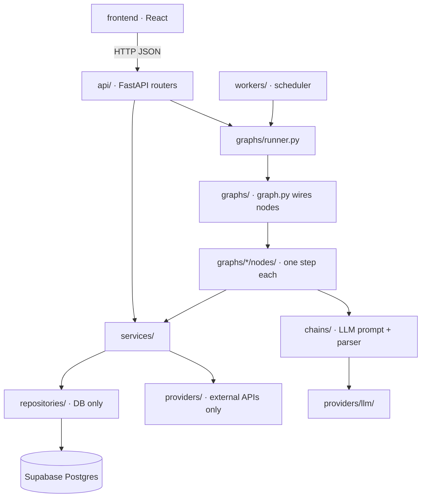

# Architecture

## Layers

Arrows point down only. A lower layer never imports a higher one.

| Layer | Responsibility |
|---|---|
| `api/` | Validate input, call a service, return a schema |
| `graphs/` | Pipeline steps. `graph.py` holds wiring only |
| `services/` | Business rules. May call a chain that is passed in, and choose which sources to use |
| `chains/` | Model calls and scoring methods, each with a free fallback where possible |
| `repositories/` | Database reads and writes only |
| `providers/` | External APIs only |
| `schemas/`, `core/` | Shared shapes and plumbing, no business logic |

## LangGraph rules

- `graph.py` contains only `StateGraph`, `add_node`, `add_edge` and `compile`.
- Each node is one file in `nodes/`, with a `run` function.
- Branch decisions live in `routes.py`.
- Nodes get the database and sources from `config["configurable"]["deps"]`.
- `graphs/runner.py` is the only way to run a graph.
- `workers/lead_job.py` builds a run's dependencies for both the Run button and the daily schedule.

## Debugging a failed search

1. Query the newest row: `select status, failed_node, error, output from graph_runs order by started_at desc limit 1;`
2. `failed_node` names the file to open in `graphs/lead/nodes/`.
3. A failed run keeps no partial data, so it is safe to run again.
4. Source failures such as `trademe: HTTP 401` appear in `output.errors` and do not fail the run.
5. `output.ai_scored` and `output.keyword_scored` show whether AI scoring ran or fell back.
