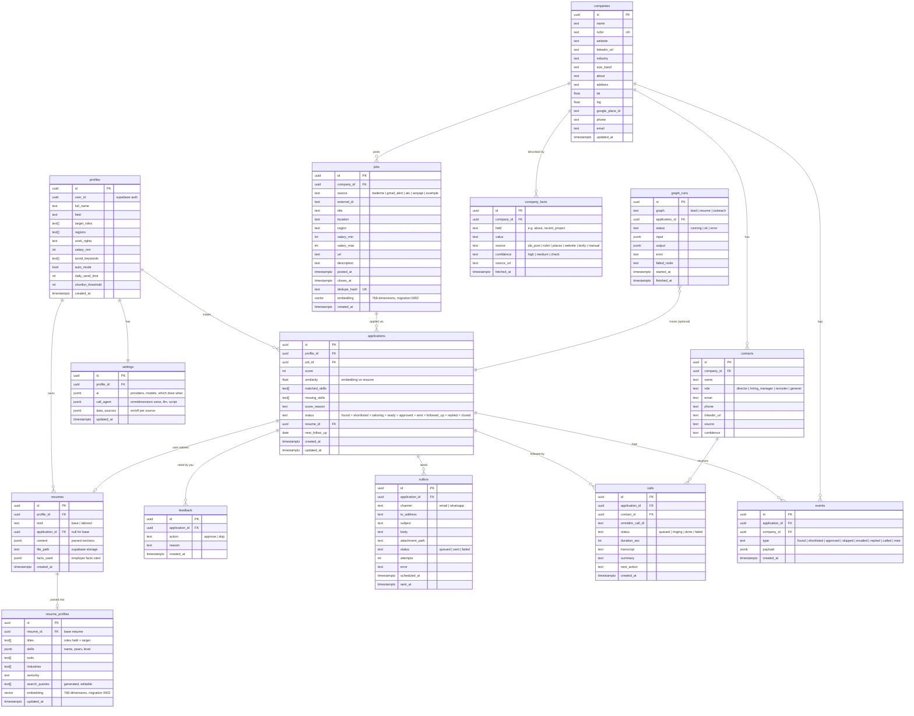

# Database

Postgres on Supabase. Migrations are plain SQL in `supabase/migrations` and also run on local Postgres.

| Migration | Purpose |
|---|---|
| `0001_init.sql` | All 14 tables, constraints, indexes, and row level security |
| `0002_embeddings.sql` | pgvector columns (768 dimensions) and an HNSW index. Skipped if pgvector is not installed |
| `0003_supabase_auth.sql` | Links `profiles.user_id` to Supabase Auth. Does nothing on plain Postgres |

## Why the main tables exist

- **resume_profiles** turns the resume into skills, titles and search queries.
- **company_facts** keeps the source and confidence of every employer detail.
- **applications** holds one job's score and status for a profile.
- **graph_runs** stores each run's input, output and failing step. A partial unique index allows one running graph at a time.

## Security

Row level security is on for every table with no policies. Supabase's public API therefore cannot read or write them. The backend connects with a database role that bypasses RLS, so `DATABASE_URL` must stay on the server.

## Changes from the original plan

- Added `profiles.shortlist_threshold`, `jobs.closes_at` and a unique `companies.name_key`.
- Added `example` as a job source and `job_post` as a fact source.
- `resumes.application_id` and `applications.resume_id` reference each other, so one foreign key is added after both tables exist.

## Diagram

