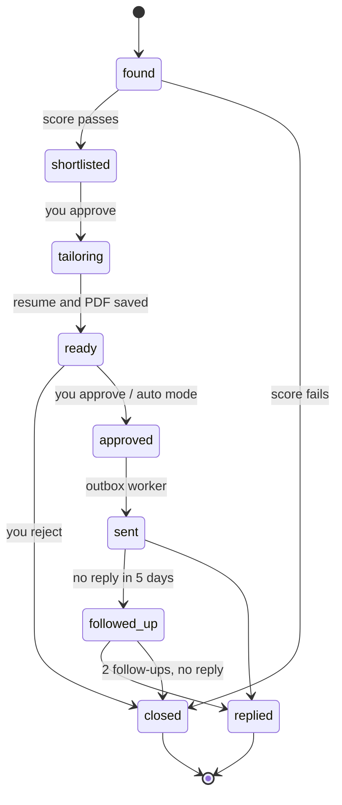

# Process flow

The full target flow. **Phases 1 and 2 build the lead graph and the resume graph.** Sending and calls come in later phases, and nothing is sent to employers yet.

## End to end

```mermaid
flowchart LR
    subgraph T1[1. Lead graph · daily 7am]
        R0[Read resume profile<br/>skills, titles, years, industries] --> Q[Build search queries<br/>title variants + top skills + regions]
        Q --> A[Fetch jobs<br/>Trade Me, Gmail alerts, ATS, SerpApi]
        A --> B[Dedupe]
        B --> C[Enrich company<br/>NZBN, Places, website, Tavily]
        C --> D0[Pre-filter<br/>embedding similarity to resume]
        D0 --> D[Score match vs resume<br/>cheap LLM, must-have skills]
        D --> E{Score >= threshold?}
        E -- no --> X[Archive]
        E -- yes --> F[Shortlist]
    end
    F --> R1{{You review shortlist}}
    R1 -- approve --> G
    subgraph T2[2. Resume graph · on approve]
        G[Read job + employer facts] --> H[Tailor resume + cover note]
        H --> I[Fact check vs base resume + job post]
        I -- unsupported line --> I2[Put back original wording]
        I2 --> J
        I -- passes --> J[Render PDF]
    end
    J --> R2{{You review resume}}
    R2 -- approve or auto mode --> K
    subgraph T3[3. Outreach graph · every 15 min]
        K[Queue in outbox] --> L{Daily limit left?}
        L -- no --> K
        L -- yes --> M[Send email]
        M --> N[Optional WhatsApp]
        N --> O[Schedule follow-up +5 working days]
        O --> P{Reply?}
        P -- yes --> RP[Mark replied]
        P -- no, 1st time --> S[Send follow-up]
        P -- no, 2nd time --> U[Optional AI call via OmniDimension]
        U --> V[Send details by email + WhatsApp]
    end
```

## Job status lifecycle

## Lead graph rules in Phase 1

- A failing job source is reported and the other sources continue.
- Any other failure rolls back the whole run and records the failing step in `graph_runs`.
- Jobs are cleaned before storage: expired posts, avoided title words, pay below the floor, and places outside your regions are removed.
- With a Claude key, up to 30 jobs per run get AI scores, best embedding matches first. All others use free keyword scoring. A job needing something you lack is capped at 40.
- Embeddings rank jobs when a Gemini key is set. A job sharing a resume skill is never dropped by embeddings alone. Similarity is calculated per run, and vectors are not stored yet.
- Past approvals and skips go into the AI prompt, or adjust keyword scores by at most 10 points.
- A final `enrich_shortlisted` step researches up to 10 new shortlisted employers per run with Places, the company website, Tavily and an AI summary. Every fact keeps its source and confidence.
- Gmail alerts are read by AI. Their links are stored and never opened.
- NZBN and Companies Office lookups are not built, because the response format is not publicly documented.
- With a Google Maps key and a real resume, each search first finds employers for your titles and towns, rotating towns day by day, and saves them. Removed employers are not added back.
- The `employer_sites` source reads 8 saved employers' websites per search, longest unchecked first. A linked Greenhouse, Lever or Ashby board is read directly. Otherwise AI lists jobs from the careers page, and any title not on the page is dropped.
- Every run stores a per-source report in `graph_runs.output.sources`, which the Pipeline page shows as "Where the last search looked".

## Resume graph rules in Phase 2

- Approving a job sets it to `tailoring` and starts the resume graph in the background. A queue every 15 minutes picks up approved jobs that have not been tried yet. Failed jobs wait for the Try again button. A tailoring run cut off by a restart is cleared after 10 minutes.
- Steps: `load_application → prepare_sections → tailor → check_facts → render_pdf → save_resume`. A failure rolls back the run, keeps the job in `tailoring`, and shows the error with a Try again button.
- Your resume is split into summary, roles, bullets, skills and education once, and cached. A part is kept only if its words appear in your resume.
- The AI may only reword bullets and choose their order. Titles, employers, dates and education come from your resume, and skills are limited to the ones it lists.
- Code check: a bullet that adds a number or a known skill not in the original goes back to the original wording. The same applies to the summary.
- AI check: a second model compares the result with your resume, the job post and the employer facts. Flagged bullets go back to the original wording, and flagged cover note sentences are removed.
- The AI writes only the body of the cover note. The app adds "Kia ora," and "Ngā mihi," with your name, so your name is not sent to the tailoring AI.
- Only employer facts with high or medium confidence are offered to the AI, and the facts used are listed on the review page.
- Without an AI key, the PDF uses your resume as it is, with a short standard cover note, and the page says AI was not used.
- Rejecting a resume closes the job. It does not count as a skip, so it does not lower future scores.

## Prep graph rules (deep search)

Deep search is an addition to the original plan. It researches one job and saves a preparation pack in `prep_packs`.

- A request makes a `prep_packs` row with status `queued`. Requests come from approving a job with the switch on, or from the Run deep search button. Only one `prep` run happens at a time; the worker takes queued rows oldest first. A 15-minute scheduler job picks up any left waiting.
- Steps: `load_job → plan → gather → extract → check_gaps → [explore] → write → save`.
- `gather` collects pages in this order:
  1. The job post.
  2. The user's extra details, as text or an allowed link.
  3. The advert URL, if allowed.
  4. The employer's website and its careers link.
  5. Google Maps.
  6. Tavily results for up to 4 planned searches. These are used from their own content and never fetched again.
  Every URL passes the same blocklist. Pages are cut to about 6,000 tokens.
- `extract`: Haiku takes notes from each page. A note is kept only if its quote (25 words or fewer) appears in that page after whitespace, case and quote marks are normalised, and its wording adds no number the quote lacks. Notes that mention a person's role (CEO, founder, director, recruiter and similar) are discarded and never stored.
- `explore` runs only when kinds the plan asked for still have no facts. The AI picks up to 3 actions (search, read a page, look up on Maps, or stop), and the code carries each one out under the same limits.
- `write`: Sonnet writes only the evidence map, interview stages, questions, things to brush up on, tips and unknowns, as structured output with one retry. The code builds the employer, pay and practical lines from verified facts, each with its quote, and adds the directions link. Facts whose quote failed go to "Could not verify". Evidence that isn't word for word in the resume is marked "check".
- Budget per run: 4 searches, 6 pages, 3 explore actions, 14 model calls, and US$0.12 estimated from token counts. Other calls stop 2 calls and US$0.05 early, so the pack can always be written. Reaching any limit ends that part of the run and adds a note saying which limit.
- Monthly limit: 30 runs by default, counted by New Zealand calendar month. At the limit the button returns 409, and approving a job skips the automatic run.
- Employer facts from a finished pack less than 30 days old are reused for the same company, with ids `r1`, `r2`, and so on. That run skips the home page and Maps. About and news facts that passed the quote check are saved to `company_facts` with confidence `medium`.
- A link on a blocked site in Extra details is refused with a 400 before anything is queued.
- A failed run sets the row to `failed` with the error, and waits for Try again. A row left `running` for more than 10 minutes is marked failed, and the `prep` run lock is cleared after 10 minutes.

## Outbox rules in Phase 3

- An approved resume waits on the Outbox under "Ready to apply" (`status = approved`, no `apply_method`). The suggested address is the first published address in the advert, then the employer's public email (`companies.email`, then `company_facts` field `email`). No-reply addresses and job-board domains are skipped.
- **Queue email** checks the address, then adds an `outbox` row (`kind = application`) with the cover note, the tailored PDF and the subject "Application for {title} – {name}", and sets `apply_method = email`.
- **I applied on the job site** sets `status = sent`, `apply_method = manual` and a follow-up reminder date. The app never emails these.
- `process_outbox` runs every 15 minutes, and straight after queueing or retrying:
  1. **Replies**, when Gmail reading is set up: for each emailed application still waiting, a Gmail search `from:{address} after:{date applied}`. A match sets `replied`, cancels pending follow-ups and adds a `replied` event.
  2. **Follow-ups**: an emailed application whose `next_follow_up` has arrived gets a follow-up `outbox` row, replying in the same thread (`In-Reply-To` the first email). After two follow-ups, the next due date closes the job instead.
  3. **Sending**, only with `EMAIL_SEND_ENABLED=true`: due rows go oldest first while today's count (NZ day) is under the daily limit. A sent application moves to `sent`, a sent follow-up to `followed_up`, and the next follow-up date is 5 working days later. A failure is retried 15 minutes later, and becomes `failed` after 3 tries. A refused app password stops the run.
- Cancelling a queued application email returns the job to "Ready to apply". Cancelling a follow-up stops follow-ups for that job.
- Working days skip Saturdays and Sundays. NZ public holidays are not skipped.
- Only one outbox run happens at a time (a database advisory lock), so an email is never sent twice. Job titles are put on one line before they go into a subject or file name.
- Known limits: an automatic reply (for example "out of office") counts as a reply, and a bounced email is not detected.
