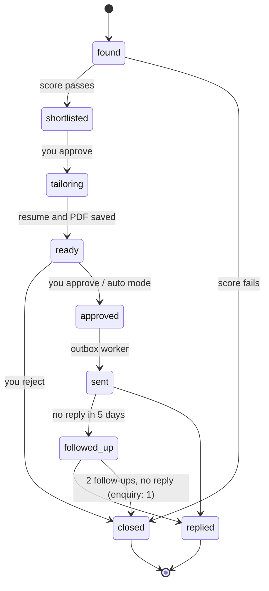

# Process flow

The full target flow. **Phases 1 and 2 build the lead graph and the resume graph.** Sending, calls, Auto mode and Google Maps outreach are built on top; nothing is sent to employers unless you turn sending on.

## End to end

```mermaid
flowchart LR
    subgraph T1[1. Lead graph · daily 7am]
        R0[Read resume profile<br/>skills, titles, years, industries] --> Q[Build search queries<br/>title variants + top skills + regions]
        Q --> A[Fetch jobs<br/>Trade Me, Gmail alerts, ATS, SerpApi]
        A --> B[Dedupe]
        B --> C[Enrich company<br/>NZBN, Places, website, Tavily]
        C --> D0[Pre-filter<br/>embedding similarity to resume]
        D0 --> D[Score match vs resume<br/>cheap LLM, must-have skills]
        D --> E{Score >= threshold?}
        E -- no --> X[Archive]
        E -- yes --> F[Shortlist]
    end
    F --> R1{{You review shortlist}}
    R1 -- approve --> G
    subgraph T2[2. Resume graph · on approve]
        G[Read job + employer facts] --> H[Tailor resume + cover note]
        H --> I[Fact check vs base resume + job post]
        I -- unsupported line --> I2[Put back original wording]
        I2 --> J
        I -- passes --> J[Render PDF]
    end
    J --> R2{{You review resume}}
    R2 -- approve or auto mode --> K
    subgraph T3[3. Outreach graph · every 15 min]
        K[Queue in outbox] --> L{Daily limit left?}
        L -- no --> K
        L -- yes --> M[Send email]
        M --> N[Optional WhatsApp]
        N --> O[Schedule follow-up +5 working days]
        O --> P{Reply?}
        P -- yes --> RP[Mark replied]
        P -- no, 1st time --> S[Send follow-up]
        P -- no, 2nd time --> U[Optional AI call via OmniDimension]
        U --> V[Send details by email + WhatsApp]
    end
```

## Job status lifecycle

## Lead graph rules in Phase 1

- A failing job source is reported and the other sources continue.
- Any other failure rolls back the whole run and records the failing step in `graph_runs`.
- Jobs are cleaned before storage: expired posts, avoided title words, pay below the floor, and places outside your regions are removed.
- With a Claude key, up to 30 jobs per run get AI scores, best embedding matches first. All others use free keyword scoring. A job needing something you lack is capped at 40.
- Embeddings rank jobs when a Gemini key is set. A job sharing a resume skill is never dropped by embeddings alone. Similarity is calculated per run, and vectors are not stored yet.
- Past approvals and skips go into the AI prompt, or adjust keyword scores by at most 10 points.
- A final `enrich_shortlisted` step researches up to 10 new shortlisted employers per run with Places, the company website, Tavily and an AI summary. Each one's contact details are looked up in the same step. Every fact keeps its source and confidence.
- Gmail alerts are read by AI. Their links are stored and never opened.
- NZBN and Companies Office lookups are not built, because the response format is not publicly documented.
- With a Google Maps key and a real resume, each search first finds employers for your titles and towns, rotating towns day by day, and saves them. Removed employers are not added back.
- The `employer_sites` source reads 8 saved employers' websites per search, longest unchecked first. A linked Greenhouse, Lever or Ashby board is read directly. Otherwise AI lists jobs from the careers page, and any title not on the page is dropped.
- Every run stores a per-source report in `graph_runs.output.sources`, which the Pipeline page shows as "Where the last search looked".

## Resume graph rules in Phase 2

- Approving a job sets it to `tailoring` and starts the resume graph in the background. A queue every 15 minutes picks up approved jobs that have not been tried yet. Failed jobs wait for the Try again button. A tailoring run cut off by a restart is cleared after 10 minutes.
- Steps: `load_application → prepare_sections → tailor → check_facts → render_pdf → save_resume`. A failure rolls back the run, keeps the job in `tailoring`, and shows the error with a Try again button.
- Your resume is split into summary, roles, bullets, skills and education once, and cached. A part is kept only if its words appear in your resume.
- The AI may only reword bullets and choose their order. Titles, employers, dates and education come from your resume, and skills are limited to the ones it lists.
- Code check: a bullet that adds a number or a known skill not in the original goes back to the original wording. The same applies to the summary.
- AI check: a second model compares the result with your resume, the job post and the employer facts. Flagged bullets go back to the original wording, and flagged cover note sentences are removed.
- The AI writes only the body of the cover note. The app adds "Kia ora," and "Ngā mihi," with your name, so your name is not sent to the tailoring AI.
- Only employer facts with high or medium confidence are offered to the AI, and the facts used are listed on the review page.
- Without an AI key, the PDF uses your resume as it is, with a short standard cover note, and the page says AI was not used.
- Rejecting a resume closes the job. It does not count as a skip, so it does not lower future scores.

## Prep graph rules (deep search)

Deep search is an addition to the original plan. It researches one job and saves a preparation pack in `prep_packs`.

- A request makes a `prep_packs` row with status `queued`. Requests come from approving a job with the switch on, or from the Run deep search button. Only one `prep` run happens at a time; the worker takes queued rows oldest first. A 15-minute scheduler job picks up any left waiting.
- Steps: `load_job → plan → gather → extract → check_gaps → [explore] → write → save`.
- `gather` collects pages in this order:
  1. The job post.
  2. The user's extra details, as text or an allowed link.
  3. The advert URL, if allowed.
  4. The employer's website and its careers link.
  5. Google Maps.
  6. Tavily results for up to 4 planned searches. These are used from their own content and never fetched again.
  Every URL passes the same blocklist. Pages are cut to about 6,000 tokens.
- `extract`: Haiku takes notes from each page. A note is kept only if its quote (25 words or fewer) appears in that page after whitespace, case and quote marks are normalised, and its wording adds no number the quote lacks. Notes that mention a person's role (CEO, founder, director, recruiter and similar) are discarded and never stored.
- `explore` runs only when kinds the plan asked for still have no facts. The AI picks up to 3 actions (search, read a page, look up on Maps, or stop), and the code carries each one out under the same limits.
- `write`: Sonnet writes only the evidence map, interview stages, questions, things to brush up on, tips and unknowns, as structured output with one retry. The code builds the employer, pay and practical lines from verified facts, each with its quote, and adds the directions link. Facts whose quote failed go to "Could not verify". Evidence that isn't word for word in the resume is marked "check".
- Budget per run: 4 searches, 6 pages, 3 explore actions, 14 model calls, and US$0.12 estimated from token counts. Other calls stop 2 calls and US$0.05 early, so the pack can always be written. Reaching any limit ends that part of the run and adds a note saying which limit.
- Monthly limit: 30 runs by default, counted by New Zealand calendar month. At the limit the button returns 409, and approving a job skips the automatic run.
- Employer facts from a finished pack less than 30 days old are reused for the same company, with ids `r1`, `r2`, and so on. That run skips the home page and Maps. About and news facts that passed the quote check are saved to `company_facts` with confidence `medium`.
- A link on a blocked site in Extra details is refused with a 400 before anything is queued.
- A failed run sets the row to `failed` with the error, and waits for Try again. A row left `running` for more than 10 minutes is marked failed, and the `prep` run lock is cleared after 10 minutes.

## Outbox rules in Phase 3

- An approved resume waits on the Outbox under "Ready to apply" (`status = approved`, no `apply_method`). The suggested address is the first published address in the advert, then the hiring address (`company_facts` `hiring_email`, newest first), then a named recruiter's email (`contacts` role `recruiter`, source `website`), then the general email (`companies.email`, then `company_facts` `email`, newest first). See Employer contact rules for how those are stored. No-reply addresses and job-board domains are skipped.
- **Queue email** checks the address, then adds an `outbox` row (`kind = application`) with the cover note, the tailored PDF and the subject "Application for {title} – {name}", and sets `apply_method = email`. An advert whose text or URL says to apply on the job site only is refused with 400 "This advert asks you to apply on the job site." Speculative records are not affected.
- **I applied on the job site** sets `status = sent`, `apply_method = manual` and a follow-up reminder date. The app never emails these.
- `process_outbox` runs every 15 minutes, and straight after queueing or retrying:
  1. **Replies**, when Gmail reading is set up: for each emailed application still waiting, a Gmail search `from:{address} after:{date applied}`. A match sets `replied`, cancels pending follow-ups and adds a `replied` event. For an enquiry, the employer is also blocked from further enquiries (`outreach_blocks`, reason `replied`).
  2. **Follow-ups**: an emailed application whose `next_follow_up` has arrived gets a follow-up `outbox` row, replying in the same thread (`In-Reply-To` the first email). After two follow-ups, the next due date closes the job instead, with the note "Closed: no reply after two follow-ups". An enquiry (speculative, see Google Maps outreach rules) gets one follow-up, then closes with "Closed: no reply after one follow-up".
  3. **Sending**, only with `EMAIL_SEND_ENABLED=true`: due rows go oldest first while today's count (NZ day) is under the daily limit. A sent application moves to `sent`, a sent follow-up to `followed_up`, and the next follow-up date is 5 working days later. A failure is retried 15 minutes later, and becomes `failed` after 3 tries. A refused app password stops the run.
- Cancelling a queued application email returns the job to "Ready to apply". Cancelling a follow-up stops follow-ups for that job. Cancelling a queued enquiry closes it, with the note "Closed: you cancelled the enquiry".
- Working days skip weekends and national NZ public holidays (Mondayised where the Holidays Act says so, Easter, King's Birthday, Labour Day and Matariki). Regional anniversary days are not skipped. Calls also wait for working days.
- Only one outbox run happens at a time (a database advisory lock), so an email is never sent twice. Job titles are put on one line before they go into a subject or file name.
- **Replies:** a reply counts only if at least one matching email is not automatic. Auto-Submitted, X-Autoreply, Precedence auto_reply, bulk or junk, or an "Automatic reply" or "Out of office" subject marks it as automatic.
- **Bounces:** checked before replies with the search `from:(mailer-daemon OR postmaster) after:{date} "{address}"`. A bounce marks the email `failed` ("Bounced: … does not accept email."), cancels follow-ups and any queued call, returns the job to `approved` with no `apply_method` (so it shows under "Ready to apply"), and sends a WhatsApp update. For an enquiry, the application is closed instead, and the employer is blocked (reason `bounced`).

## Employer contact rules

Code: `services/contact_service.py`, `services/contact_extract.py`, `chains/recruiter_chain.py`.

**When a lookup runs**
- On save (background job `refresh_contacts`, not forced), in the daily research for employers picked by `needing_research`, and on `POST /employers/{id}/contacts` (forced).
- On approving a job (background `refresh_contacts`, not forced), in Auto mode when an approved advert has no address (see Auto mode rules), and before each Google Maps enquiry (see Google Maps outreach rules).
- The Outbox **Find contacts** button (`POST /applications/{id}/find-contacts`) is forced.
- A lookup that is not forced returns early if `contacts_checked_at` is within 30 days (`RECHECK_AFTER`). The forced one always reads.
- The background job logs its errors and never raises. In research, the lookup runs in a savepoint: a failure is recorded and the rest of research carries on.

**Pages read**
- The home page is `companies.website`. A website with no scheme (such as `www.example.co.nz`) is read at `https://`; a website that has a scheme other than http(s) is not read. A website on a blocked job board or LinkedIn, or an IP address, is not read either. The lookup then notes that instead.
- The contact page is the first link on the home page whose text or path contains "contact" or "get in touch". Fragments are dropped first, so `#contact` is the home page itself: it is not read again, and not stored as a page link.
- The careers page is the highest-scoring careers link on the home page. Main careers text (careers, jobs, vacancies, join us and similar) scores 3, other career words score 2, and a career word in the path or a hiring-system link scores 1. Scholarship, graduate, intern, blog, news and story pages lose 1.
- A page is read only if its host equals the website's host after removing `www.`. Hiring systems (Workday, SmartRecruiters and similar) and other subdomains such as `careers.` are stored as links but not read.
- The contact page is read before the careers page. At most 3 reads per lookup, home page included, so the most AI checks are 2.

**Emails and phones**
- Every address on each page read is taken in page order, lower-cased. Addresses that are not valid, are no-reply (`no-reply`, `donotreply`, `mailer-daemon`, `postmaster`) or are on a job-board domain are skipped. Addresses on other domains are kept if the page shows them.
- Hiring local parts (the part before @): careers, jobs, job, hr, recruit, recruitment, recruiting, talent, people, employment, vacancies, apply. These are stored as `hiring_email`. Any other address is stored as `email`.
- `companies.email` is set to the first general address, only while it is empty. Hiring addresses never go there.
- Replace, not add: a lookup that read every page it attempted replaces this employer's `website` facts for the contact fields (`email`, `hiring_email`, `phone`, `contact_page`, `careers_page`, `linkedin`) with what it found, so a changed phone or address stops being shown. A lookup where a page read failed only adds, so a partly blocked site does not erase known details. Facts from other sources are never deleted.
- NZ phone numbers on each page are stored as written on the page, once per number.

**Named recruiter check (AI)**
- The AI reads only the contact and careers pages, at most 20,000 characters each. It never sees the home page. With no Claude key, or with only the home page read, no check runs.
- A person is kept only if all of these hold:
  - the name appears on the page;
  - the quote is 25 words or fewer and appears on the page;
  - the role matches recruit, talent, human resources, HR, people, hiring or careers;
  - the email, if one is given, appears on the page.
- A name found on more than one page is kept once. A phone is kept only if it matches a number on that page.
- A kept person is stored as a `contacts` row: role `recruiter`, source `website`, confidence `check`, with their title, the page URL and the checked time. Their email is not stored as an `email` or `hiring_email` fact, nor as `companies.email`.
- Old website recruiter rows are replaced only when at least one check finished without an error. If the AI failed on every page, or no check ran, the old rows stay.

**Facts and sources**
- From the website, confidence `high`, with `source_url` set to the page it came from: `email`, `hiring_email`, `phone`, `contact_page`, `careers_page` and `linkedin`. If the same address or number was already stored from a job advert (`job_post`), the website copy takes over that row (source `website`, the new `source_url` and time). A number already stored from Google Maps (`places`) keeps its Maps source.
- Order: newest first. Within one lookup, the order the addresses and numbers appear on the pages (home page, contact page, then careers page). The Outbox suggests the newest `hiring_email` and `email` first.
- From Google Maps (`places`, `high`): `phone`, `address`, `website`, `opening_hours` (days joined with `; `) and `rating` (for example `4.4 (7)`). A rating is shown only with its count.
- Phone shown: Google Maps first, then the website, then the job advert, each labelled with its source.
- LinkedIn: the first `linkedin.com/company/` link found, the home page first. It is stored as a fact, and fills `companies.linkedin_url` only while that is empty. It is never fetched.
- Contact and careers page links come from the home page only, and are stored even when not read, if the address is allowed.

**`contacts_checked_at`**
- Set on every lookup that is not skipped and runs a check, unless a page read failed for a transient reason: a request failure or timeout ("request failed (...)"), HTTP 429, or HTTP 5xx. Those lookups leave it as it was, so the next automatic lookup reads again.
- Also set when a refusal (HTTP 401, 403, 404 or 410, "the site refused access (...)", "this address is not allowed") or "No website to read." ends the lookup, so a site that refuses access is not retried automatically for 30 days. The button still reads it again.
- Not set on the 30-day skip, or when there is no reader.

**`contacts_attempted_at`**
- Set on every read of the employer's website, even when the read failed. Auto mode uses it to retry at most once an hour.
- Not set when there is no website, the address is not allowed, or there is no reader.
- A read that fails with no pages, other than a transient failure (see above), stores `site_unreadable`, which the Outbox contacts list reports as "Could not read the website". A later read with pages clears it.

**Notes.** A lookup lists each problem it met, using one of these five texts. The notes are not stored, and a skipped lookup returns none.
- "No website to read."
- "Website reading is not set up."
- "Could not read the website (address not allowed)."
- "Could not read the website | contact page | careers page ({reason})."
- "Could not check for a hiring contact."

**What `needing_research` ignores.** An employer counts as researched when it has a `places` or `tavily` fact, or a `website` fact in a field other than `email`, `hiring_email`, `phone`, `contact_page`, `careers_page` or `linkedin`. Contact facts alone do not count, so the employer can be picked again by the daily research. The lookup itself then returns early until 30 days have passed.

**Access.** `GET` and `POST /employers/{id}/contacts` work only for a saved employer of this profile, or the employer of one of this profile's applications. Anything else returns 404 "employer not found".

**Removing an employer.** It leaves the saved list and later searches do not add it back. Its stored contact details and company facts are kept. Daily research of a shortlisted job's employer is not affected by this.

**Suggested Outbox address.** The first valid address in the advert is used. Otherwise the first of these: a `hiring_email` fact (newest first), then a named recruiter's email (website source), then `companies.email`, then the other `email` facts (newest first). Each candidate is checked and lower-cased, and the first valid one is used.

## Calls and WhatsApp rules in Phase 4

- **When a call is made:** an emailed application reaches its closing date after two follow-ups with no reply. An enquiry (speculative) never makes a call. With `CALLS_ENABLED`, an OmniDimension key and an agent ID, the app tries a call before closing the job. It queues a `calls` row (`purpose = follow_up`) to the employer's published number, `companies.phone` first, then `company_facts` field `phone`, converted to +64, and stops further follow-ups. It doesn't queue a call when:
  - there is no usable number,
  - the job already had a call, or
  - the month's limit (`MAX_CALLS_PER_MONTH`, NZ month) is reached.

  In those cases the job closes as before.
- **Each outbox run** (15 minutes, one at a time) does three things:
  1. It fetches results for calls that are ringing. It reads `/calls/logs` for the agent and matches `metadata.app_call_id`.
     - It saves the status, duration, transcript and extracted variables.
     - An email address given on the call is kept as `captured_email`: the extracted `contact_email` first, otherwise the first address found in the transcript.
     - `completed` becomes `done`. Voicemail, busy, no answer, or no record after 2 hours becomes `failed`.
  2. It dispatches queued calls, only Monday to Friday, 9:30 to 4:30 NZ time.
  3. It delivers WhatsApp updates.
- **What each call carries:** `call_context` holds the candidate name and email, job title, company, applied date and summary. `metadata.app_call_id` links the call to its result. With `EMAIL_ADDRESS` set, `__post_call_actions.email` emails the user a summary and extracts `contact_email`.
- **Cancelling a call:** a call that hasn't been made yet is cancelled when a reply is detected, or when you press They replied, Close or Stop follow-ups.
- **Email after a call:** "Email my resume to …" queues an `outbox` row (`kind = after_call`) with the cover-letter text and the tailored PDF. It doesn't change the job's status.
- **WhatsApp:** updates go only to `WHATSAPP_TO`, through the user's own WhatsApp service. A `dedupe_key` means each event is sent once, and an update is retried up to 3 times. Updates are stored only when WhatsApp is switched on.
- **Test buttons:** "Test call to my phone" calls the number under "Your details for resumes", and counts toward the monthly limit. "Send me a test WhatsApp" sends one message straight away.

## Auto mode rules in Phase 5

- **Settings:** stored in `profiles.auto_mode` (on/off) and `settings.ai.auto` (`min_score` 0–100, default 80; `daily_limit` 0–20, default 5). It's off by default. The Google Maps settings are in `profiles.prospects_enabled`, `profiles.prospects_per_day` and `profiles.business_types` (see Google Maps outreach rules).
- **When it runs:** first in every outbox run, under the same lock, before replies, follow-ups, sending and calls. It skips any profile that is switched off or has no uploaded resume of its own.
- **Jobs:** shortlisted jobs with `score >= min_score` from real sources (never `example`), best score first, up to `daily_limit` per NZ day (counted by `applications.auto_approved_at`). Each is approved through the normal decision (feedback row, `approved` event), marked `auto_approved_at`, noted "Approved by auto mode", and passed to deep search's approval hook.
- **Resumes:** status `ready` and `auto_approved_at` set → the resume is approved through the normal review decision. Resumes for jobs the user approved by hand are never approved automatically.
- **Emails:** for auto-approved jobs that are `approved` with no `apply_method`:
  - An advert that says to apply on the job site only is never queued. `applies_on_site_only` in `services/advert_contact.py` is true for these phrases: "apply online only", "apply only through", "applications through seek only", "only applications submitted", "please do not contact", "no direct approaches", "no direct contact", "no agencies or direct contact", "no direct applications", "via our careers site only", or a `jobs.govt.nz` address. It gets a one-time WhatsApp update to apply on the job site.
  - Otherwise the suggested address (`suggested_address`: the advert first, then the employer's record) is queued with `queue_email`.
  - With no address, if the employer has a website that is not yet checked (`contacts_checked_at` empty), auto mode waits. The lookup runs first, at most once an hour (`contacts_attempted_at`), and the wait ends 24 hours after the auto approval.
  - Otherwise, including no website, or a site already checked with no email, the job stays in "Ready to apply" and gets the one-time WhatsApp update: "Auto mode approved {title} at {company}. No email address found ({reason}). Apply on the job site from the Outbox." The reason is the one the Outbox contacts list gives (`outbox_contacts.missing_reason`), so an unreadable site and a checked site with no email read differently.
- **Not affected by auto mode:** the email send switch, the daily send limit, follow-ups, reply detection, AI calls and their monthly limit, and the WhatsApp settings all apply unchanged.

## Google Maps outreach rules (Phase 6)

Code: `services/prospect_service.py`, `workers/lead_job.py` (`run_prospecting`), `workers/scheduler.py`, `services/employer_service.py`, `services/auto_service.py` (`_queue_speculative`), `services/outbox_service.py`.

- **Switch.** Runs only when Auto mode and `profiles.prospects_enabled` are both on. Saving with Auto mode off stores the switch as off.
- **Switch off.** Turning the switch off (directly, or with Auto mode) runs `outbox_service.stop_speculative_outreach` in the same save: queued, draft and failed enquiries are cancelled, approved enquiries that were never sent are closed with "Closed: Google Maps outreach was turned off", and sent ones stop their follow-ups (they stay sent, so replies and bounces are still seen). While the switch is off, queueing, follow-up scheduling and automatic sending skip enquiries, and a skipped queued one is cancelled, not sent. A user's own Send on a draft is unchanged.
- **One run at a time.** `run_daily` takes a session advisory try-lock per profile before it counts today's enquiries. A run that finds the lock held creates nothing and logs a line.
- **When it runs.** After the daily search (`daily_search_hour`, 7 am NZ), once per run. A failure is logged and does not stop the scheduler.
- **Business types.** With `business_types` set, discovery searches "{type} in {town}" for each town and type, instead of job titles. The saved `discovery_cursor` says which search is next and moves on by one for each search made, so the next run carries on. This applies even with Auto mode off.
- **Daily cap.** At most `prospects_per_day` (1 to 10, default 5) new speculative applications per New Zealand day. Only this profile's speculative records count, from midnight NZ.
- **Order and filters.** Saved employers, oldest saved first. An employer is passed over, with nothing counted and tried again on a later day, when it has no address, is outside the areas, or has any application from this profile. An employer already in `outreach_blocks` is passed over.
- **Lookup first.** The employer's website is looked up (not forced, so a check within 30 days is reused). If the lookup fails, the employer is passed over for this run.
- **Unsolicited wording.** When a page says one of "no unsolicited", "do not accept unsolicited", "not accept unsolicited", "no recruitment agencies" or "no cold calls", the lookup stores company fact `no_unsolicited`. The employer is then blocked with reason `no_unsolicited` and counted as `blocked`.
- **No email.** When the site gives no hiring or general email, nothing is created, the employer is counted as `skipped_no_email`, and it is not blocked.
- **Record.** Otherwise one `applications` row with `kind = speculative`, status `approved` and `auto_approved_at` set. It has the master CV (in its chosen design) as a PDF and Word file, and a cover note. Its job is one "Speculative application" Maps job per employer (`source = nearby`).
- **Cover note.** With a Claude key, AI writes it. Sentences that add a number or skill the CV does not have, or mention a declined skill, are dropped. Without AI, it is: "I'm getting in touch to ask whether {name} has any work coming up. My resume is attached, and I'd welcome the chance to talk about how I could help."
- **No roles.** When the master CV has no roles, the run stops at the first employer that passes the filters and sends the note "Add your work history in the Resume builder to start Google Maps outreach." once per New Zealand day.
- **Queueing (Auto mode).** A blocked employer closes the enquiry with "Closed: the employer is blocked from enquiries". No address closes it with "Closed: no email address published". Otherwise it is queued to the suggested address, and an update says "Auto mode is sending your enquiry to {company} to {address}."
- **Email.** Subject "Enquiry about opportunities at {company} – {name}" (without the name when unknown). Body: the cover note with the full signature, then "If you'd rather I didn't contact you again, just reply and I won't." Attachment "{name} - CV.pdf" (or "CV.pdf"). Adverts go first within the daily limit.
- **Follow-up.** One follow-up, in the same thread: "Kia ora," then "I'm following up on my earlier email about opportunities at {company}, sent on {date}", your signature and the same stop line. Then the job closes with "Closed: no reply after one follow-up". It never makes a call.
- **Reply** blocks the employer (`replied`). **Bounce** closes the enquiry and blocks the employer (`bounced`). **Cancelling** a queued enquiry closes it ("Closed: you cancelled the enquiry").
- **Changing areas** (saving changed areas on the profile) closes found and shortlisted applications whose place is outside the new areas, with the note "Outside your areas". Empty areas close nothing.

## Evening summary rules

Code: `services/notify_service.py` (`daily_summary`, `send_daily_summaries`), `workers/scheduler.py` (`run_daily_summaries`).

- A job runs at 18:00 New Zealand time, with no catch-up.
- For each profile with activity that New Zealand day, one notification `daily_summary` is queued (once per profile per day). The text is "Today: " followed by the items below, joined with ", ", and ending with a full stop. Items with a count of zero are left out:
  - "1 application sent" or "N applications sent" (advert emails sent that day)
  - "1 follow-up" or "N follow-ups"
  - "1 reply" or "N replies"
  - "1 bounced email" or "N bounced emails"
  - "1 Google Maps employer emailed" or "N Google Maps employers emailed" (enquiries sent that day)
  - "1 job to apply for on its site" or "N jobs to apply for on their sites" (apply-on-the-site notices)
- A quiet day queues nothing. Nothing is queued unless WhatsApp is set up. The text never includes an employer's email address or phone number.

## WhatsApp Web link

- `whatsapp-service/` is a small Node service using Baileys 6.7.24. It listens only on `127.0.0.1:3010` (`WA_PORT`) and has three routes:
  - `GET /status` returns `{state, qr, me, error}`. `state` is one of `starting`, `qr`, `connected`, `reconnecting`, `logged_out` or `error`, and `qr` is a PNG data URL.
  - `POST /send` takes `{to, message}`.
  - `POST /logout` unlinks.
- `/send` only messages the linked account's own number, or the numbers in `WA_ALLOWED_TO`. Before linking it answers 503.
- When the phone unlinks, the session in `whatsapp-service/auth/` is deleted and a new QR code is shown.
- The backend calls the same address as `WHATSAPP_SERVICE_URL` (default `http://127.0.0.1:3010/send`), plus `/status` and `/logout`. Settings › WhatsApp checks `/whatsapp/status` every 3 seconds until linked. If the service isn't running, it shows `offline` and says how to start it.

## Master CV rules (resume builder)

Code: `services/master_cv_service.py`, `api/master_cv.py`, `repositories/resumes_repo.py`, `repositories/profiles_repo.py`.

**Storage**
- The master CV lives in the base resume's `content`: `sections` (headline, summary, roles, skills, education, interests, referees), `contact` (name, email, phone, location, LinkedIn, WhatsApp, work rights) and `template` (`classic`, `modern`, `compact` or `executive`; anything else reads as `classic`).
- `PUT /master-cv` writes sections, contact and template in one update. It needs a base resume that is not the example profile, otherwise it returns "Upload your resume first, then build on it here."
- Size limits are checked when the CV is sent (up to 20 roles, 20 bullets per role, 80 skills, 20 education lines, 2,000 characters per text field). The limits are not checked when a saved CV is read back.

**Loading**
- Cached sections are used first (source `resume`).
- With no cached sections, the AI section reader runs when a Claude key is set and the resume has text (source `ai`). The result is cached.
- Otherwise (source `empty`) the form's Key skills are the resume profile's skills. This is display only: nothing is saved until Save CV.
- A saved CV with no roles is a skeleton, not the CV. Tailoring and the prep pack do not use it: they use the uploaded text, and the plain cover note. Saving such a form does write its sections, and tailoring and the prep pack still ignore them. "I have this" with no AI never writes sections.
- Contact defaults to the stored contact, or to details read from the resume text (name, email, phone, LinkedIn).

**Saving and the resume profile**
- Saving writes the CV, then syncs the resume profile. The sync only adds:
  - the headline is added to the titles, unless it already matches one (ignoring case);
  - each key skill not already in the profile's skills or tools (ignoring case) is added as a skill;
  - tools are not touched, and nothing is removed.
- If the contact has a name, the profile's full name is set to it.
- Saving returns the CV with its ATS check.

**ATS previews**
- `with_ats` renders the PDF and Word file for the chosen design under `upload_dir/previews/` with unique temporary names, runs the ATS check, and only then moves the files to `{profile_id}.pdf` and `{profile_id}.docx`. The previews are replaced each time, so concurrent requests never read a half-written file.
- If anything fails, the report holds one item, "ATS check could not run", with the error type. The CV page and saving still work.
- `GET /master-cv` and `PUT /master-cv` run the check. `GET /master-cv/file?format=pdf|docx` renders a fresh copy into a temporary file, which is deleted after the response.

## Contact redaction rules

Code: `core/documents.py` (`redact_contact_details`, `contact_for_text`, `ai_resume_json`). Used before any text goes to an AI provider: section reading (`ResumeSectionsChain`), profile reading (`ResumeProfileChain`), the prep pack writer (`WriteChain`), the tailoring writer (`TailorChain`) and the fact check (`FactCheckChain`).

- Email addresses and phone numbers are always replaced: an email with `[email removed]`, and a phone of 8 to 15 digits with `[phone removed]`. A run of years such as `2019 - 2021` is kept.
- The stored contact is merged per field with the details read from the text: a stored value wins, and a blank field is filled from the text. So a blank stored name still redacts the name in the text.
- The name is removed as a whole phrase, ignoring case and spacing, and a name ending in punctuation (such as "Jr.") is removed too. A name shorter than 4 characters is not removed.
- The LinkedIn URL for the stored handle is removed, with or without `https://`, `http://` or `www.`, in any case, with or without a trailing slash.
- Its WhatsApp number is removed where the text has a phone number with the same digits (after dropping the NZ `64` code and trunk zero).
- Location and work-rights wording in the body are left in, because roles need their locations and the work-rights line is needed for the CV.
- Parsed sections are sent as JSON without referees and without role locations (`ai_resume_json`). The raw resume text is sent redacted, and only when there are no parsed sections (prep pack writer).
- The tailoring AI and the fact check never receive the contact block. The greeting and sign-off are added by the app.

## Designs and layout order

Code: `core/resume_layout.py` (blocks and looks), `core/resume_pdf.py`, `core/resume_docx.py`.

**Order.** Every design prints the same blocks, in this order:
1. Name (when filled in).
2. Headline (when filled in).
3. Contact line: city · phone · email · LinkedIn, plus `WhatsApp …` only when the WhatsApp number is a different number from the phone (compared as NZ numbers, then by digits).
4. Work-rights line (when filled in).
5. Heading **Profile**, then the summary (when filled in).
6. Heading **Key skills**, then the skills joined with `, ` (Compact uses ` · `).
7. Heading **Work history**. Each role prints its title with its dates on the right, then employer and location, then its bullets (empty bullets are skipped).
8. Heading **Education and certifications**, then each line.
9. Heading **Interests** and its text, only when interests are filled in.
10. Heading **Referees**, then the text (defaults to "Available on request.").

Headings print even when their section is empty. Without parsed sections, the PDF and Word file print the name, the contact line and then each line of the resume text as plain text.

**The four looks**

| Design | Accent | Name | Headings (PDF) | Word fonts |
|---|---|---|---|---|
| Classic | black | centred, 20 pt | uppercase, with a rule | Georgia |
| Modern | `#0F5C5C` | left, 20 pt | uppercase, with a rule | Calibri |
| Compact | `#1F3A5F` | left, 15 pt, smaller text (8.5 pt) | uppercase, with a rule | Arial |
| Executive | `#1F3A5F` | left, 20 pt | 11 pt, not uppercase, no rule; a rule under the contact line | Cambria headings, Calibri text |

- PDF: A4, all four designs in DejaVu Sans (bundled), margins 18 mm sides and 16 mm top and bottom. Headings keep with the next line, so a heading is not left alone at the foot of a page.
- Word: A4, the same margins, no tables, text boxes, images, headers or footers. Only the name and the lines above the headings take the look's alignment. Headings, body text, entries, role lines and bullets are left-aligned. Bullets use the List Bullet style.
- The look changes accent colour, heading style, name alignment and spacing. Compact also uses smaller type (15 pt name, 8.5 pt text and headings, against 20 pt and 9.5 pt elsewhere). Content and order never change between designs.

## ATS check rules

Code: `services/ats_check.py`. The check reads the text of the generated PDF with pypdf, which is what an applicant tracking system sees. It returns nine items, each with `ok` and a detail. There is no score.

1. **One column, no tables, text boxes or images.** Always ok: every design is built this way. The detail says so. This item is not tested.
2. **Name and contact details at the top of the page body.** Fails with "Add your name." when there is no name. Fails with "Put your name on the first line." when the first non-empty line of the PDF text is not the name (ignoring case and spacing). Fails with "Add an email or phone number." when neither is set.
3. **Standard section names in the NZ order.** Expected order: Profile, Key skills, Work history, Education and certifications, Interests (only when filled in), Referees. The check looks for these whole lines in that order. Missing headings are listed ("Missing: …"). When all are present but out of order, the detail is "Headings are out of order."
4. **Dates as month and year.** With no roles, ok with "No roles yet.". Each role's dates must match a month name (three letters, optionally more), a year, a dash (en dash or hyphen), then `Present` or another month and year. Roles that fail are listed by title.
5. **2 pages or fewer.** The PDF's page count from pypdf. The detail says "1 page" or "N pages".
6. **Profile of 50 to 150 words.** Counted by splitting the summary on spaces. The detail gives the count.
7. **No photo, date of birth, gender, marital status, nationality or religion.** Flags these words only as field labels: at the start of a line, or after `·` or `|`, followed by `:` or `-` (for example `Gender: …`). Ordinary words such as "Gender equality" pass. The check cannot see a photo. The detail lists what to remove.
8. **Work rights stated.** Ok when the work-rights line is not empty.
9. **Files under 2.5 MB.** Both the PDF and the Word file must be under 2,621,440 bytes. The detail gives both sizes in KB.

## Requirements from the ad

Code: `chains/score_chain.py`, `services/coverage_service.py` (`requirements`), `services/application_service.py`, `supabase/migrations/0009_resume_builder.sql`.

- **AI scoring** (the existing scoring call) also returns `required_skills` and `preferred_skills`, in the ad's wording, up to 12 each. Each must appear in the ad text (whole word, ignoring case, plurals allowed), or it is dropped. The ad's own wording is kept. A preferred skill that is also required is dropped from the preferred list. `requirements_split` is set to true.
- **Keyword scorer** (no AI): required = the skills it matched on the resume, then the missing skills from its known list that the ad mentions. Preferred is empty and `requirements_split` is false. The UI calls this group "Skills the ad mentions".
- **Pre-0009 and empty requirements:** an application with no required and no preferred skills (rows scored before migration 0009, or a scored row with none extracted) takes its matched and missing skills as one required group, with `requirements_split` false.
- Migration 0009 adds `required_skills`, `preferred_skills` and `requirements_split` to `applications`, with empty defaults, so existing rows are not changed.

## Skill coverage rules

Code: `services/coverage_service.py`, `core/skill_synonyms.py`, `repositories/skills_repo.py`. Routes: `GET /applications/{id}/coverage`, `POST /skills/decision`.

**Search order.** Each skill is searched for in the master CV in this order, and the first place that matches is the evidence:
1. Each role: its title, then its bullets. Evidence: "Shown in: {title}, {dates}".
2. The headline, then the summary. Evidence: "Shown in: Profile".
3. Key skills. Evidence: "Shown in: Key skills".
4. Education lines. Evidence: "Shown in: Education".

Matching is whole word or phrase, ignoring case, with an optional plural (see `core/normalize.py`). Skills of two characters or fewer (such as Go) match only in the case typed, so "Go" is not found in "we go live" but is found in "Go and Python". This rule applies to coverage and the declined-skill check only.

**Synonyms.** Each skill is checked by its own name first, then by every name linked to it, directly or through another name. The seed list is in `core/skill_synonyms.py` (AWS / Amazon Web Services, GCP / Google Cloud, JavaScript / JS, TypeScript / TS, PostgreSQL / Postgres, SQL Server / MS SQL, Power BI / PowerBI, Excel / Microsoft Excel / MS Excel, Kubernetes / K8s, Machine learning / ML, CI/CD / continuous integration, .NET / dotnet, Node.js / NodeJS, React / React.js). When a linked name matched, the result shows "Matched as {name}".

**Statuses**
- `shown`: found in the CV, with the evidence above.
- `added`: a Key skills match for a skill the user chose "I have this" for. Evidence: "Added by you to Key skills". A role, profile or education match takes precedence and gives `shown`.
- `declined`: the user chose "Not me" and the CV does not mention the skill. Evidence: "You said you don't have this.". A "Not me" answer does not hide a match: if the CV mentions the skill, it is `shown`.
- `missing`: none of the above. Evidence: "Not in your CV yet".
- Covered = `shown` or `added`. The count reads "N of M" for each group. "No skills found in this ad." appears when both lists are empty.

**Which sections are checked.** The master CV is loaded, reading the sections with AI if needed. If the master CV has no content at all (no headline, summary, roles, skills or education; interests and referees do not count), the resume profile's skill names (skills, then tools, without repeats) stand in as Key skills. With no base resume at all, Key skills are empty and the counts still show. If the AI cannot read the sections, the same stand-in is used, so the Shortlist still loads and counts. The Resume review page counts the tailored sections when the tailored resume used the master CV, and otherwise the same sections as the Shortlist, so the two counts agree.

**Decisions.** `POST /skills/decision` takes `{skill, decision}`, where `decision` is `have`, `no` or null (undo). Decisions are keyed by the skill name ignoring case, one per profile.
- **Have:** stores the decision with `skill_decisions.added` set to true only when this answer added the skill to the resume profile or the master CV. The skill is added to the resume profile's skills (unless already listed) and to the master CV's Key skills (when the CV has content, and unless already listed). A blank master CV is not written to. Repeating "have" keeps the `added` flag as it was.
- **No:** stores the decision. If the previous decision was "have" and `added` is true, the skill is removed from the resume profile's skills and from the master CV's Key skills. Tools are not removed. A skill the user already had stays.
- **Undo (null):** deletes the decision. If the previous decision was "have" and `added` is true, the skill is removed as above.
- Migration 0010 (`supabase/migrations/0010_skill_decisions_added.sql`) adds `added` with `alter table skill_decisions add column if not exists added boolean not null default false`. A database that recorded 0010 before this column existed needs that statement run once. Until then, undo does not remove a skill.
- Decisions do not change the match score. They change coverage and what tailoring may say.
- In the UI, **I have this** and **Not me** appear only for `missing` skills, and **Undo** only for `added` and `declined` skills.

## Tailoring changes (resume builder)

Code: `graphs/resume/nodes/*.py`, `services/tailoring_service.py`, `services/resume_build_service.py`, `services/resume_review_service.py`.

- **Template.** The tailored resume uses the master CV's design at the time tailoring runs (default `classic`). The PDF and the Word file use the same design.
- **Fact-check source.** Claims are checked against the uploaded resume text plus the master CV text (headline, summary, role titles and bullets, skills, education and interests). This is the only text a tailored claim can rely on. The AI fact check receives the sections, the tailored draft, the employer facts and the job, not the contact block.
- **Titles, employers, dates, education, interests and referees** always come from the base resume. The model only rewrites bullets and the summary, and orders the skills it already has.
- **Code checks** (`check_facts`), run on each bullet and on the summary:
  - a bullet that adds a number the original bullet does not have, or a known skill that its own role does not mention, goes back to the original wording;
  - the summary goes back to the base summary when the rewrite adds a number or known skill that the source does not have;
  - a bullet, or the summary, that mentions a declined skill the source does not mention goes back to the original.
- **Declined skills.** A declined skill is one the user chose "Not me" for. Any bullet, summary or cover-note sentence that mentions it (or a linked name) and that the master CV does not mention is reverted or removed. Uploaded text alone does not count: the master CV's headline, summary, roles, skills and education do. The note says "Removed a mention of {skill}, which you said you don't have." A declined skill is also dropped from the tailored Key skills list unless the master CV lists it.
- **AI check.** A second model compares the draft with the source. Flagged bullets, a flagged summary and flagged cover-note sentences are reverted or removed, each with a note. If the check is unavailable, the notes say "The AI fact check was unavailable, so only the automatic checks ran."
- **Master CV used only with roles.** Tailoring uses the master CV's sections only when they have at least one role. Otherwise the resume counts as having no parsed sections.
- **Without AI** (no tailoring model, or no sections with roles), the PDF and Word file use the uploaded text as it is, with a short standard cover note. The code checks and declined-skill removal do not run in this case.
- **Word file.** Written beside the PDF with the same name (`.docx`). If it fails, the failure is logged without any CV text, any partial file is removed, and the note "The Word file could not be made this time. The PDF is ready." is added. Tailoring still finishes and the PDF is still saved.
- **Coverage on review.** The Resume review page counts the tailored sections when the tailored resume used the master CV. Otherwise it counts the same sections as the Shortlist (the master CV, or the profile's skills as a stand-in), so the two counts agree.
- **Email.** The PDF is still the attachment, not the Word file.

## Signature rules

Code: `services/outbox_service.py` (`signature`, `sign_cover_note`, `follow_up_body`).

- The sender details come from the base resume's stored contact (or details read from its text when none is stored).
- The signature is the name line, `Ngā mihi,` then the name (or just `Ngā mihi` with no name), then the numbers:
  - when the phone and WhatsApp numbers are the same (as NZ numbers, or by digits), `Phone and WhatsApp: {phone}`;
  - otherwise `Phone: {phone}` when there is a phone, then `WhatsApp: {whatsapp}` when there is a WhatsApp number.
- **Application emails:** the cover note's usual sign-off (`Ngā mihi,` and the name, at the end) is replaced with the signature. A note without that sign-off gets the numbers added at the end.
- **Follow-ups:** the body is `Kia ora,`, the follow-up text (the first says the sent date; later ones say "once more") and the signature.
- The PDF is not changed.
- The app never sends WhatsApp messages to employers. WhatsApp is used only for updates to the user (see WhatsApp Web link).

## Follow-up drafts lifecycle

Code: `workers/outbox_job.py` (`_schedule_follow_ups`), `services/outbox_service.py` (`send_draft`, `cancel`), `repositories/outbox_repo.py`. Routes: `GET/PUT /settings/follow-ups`, `POST /outbox/{id}/send`.

- **Setting:** `settings.ai.follow_ups.mode`, `auto` (the default) or `ask`. It is read each time a follow-up is due, so a change applies from then on. It does not change rows already queued or waiting.
- **When a follow-up is due:** an emailed application (`apply_method = email`, status `sent` or `followed_up`) whose `next_follow_up` date has come, and which has fewer follow-ups than its limit (two for an advert, one for an enquiry), gets one follow-up. If one is already queued, waiting or failed, nothing else is added.
- **Auto:** a `queued` follow-up row is made, threaded on the first email. It goes out on the next run, within the daily limit and only when sending is on.
- **Ask:** a `draft` row is made instead, with the same text. The job's `next_follow_up` is cleared, so no second draft is made. A "Follow up today" notification is sent.
  - **Send** (`POST /outbox/{id}/send`) changes the draft to `queued`, due now. It goes out on the next run, within the daily limit. Once sent, the job is `followed_up`, the count goes up by one and the next date is 5 working days later.
  - **Skip** (cancel) sets the draft to `cancelled` and clears the follow-up date for that job. No more follow-ups are made for it, and the job stays open (it is not closed automatically, because the closing check needs a follow-up date).
  - A draft that is neither sent nor skipped stays `draft` and waits indefinitely. Nothing is sent, and the job's follow-up date stays cleared, so it is never closed automatically either.
- **Closing after two follow-ups:** when a job has two follow-ups and its next date comes, it is closed (or sent to an AI call when calls are on), in both modes. An enquiry is closed after its one follow-up, with no call, in both modes. In ask mode this only happens after the second follow-up has been sent.
- **Cancelling:** "They replied", "Close" and "Stop follow-ups" cancel queued, failed and draft follow-ups for the job. Cancelling a draft directly does the same as Skip.
- **Outbox page:** the drafts appear under **Follow-ups waiting for you**, with **Send** (queues it now) and **Skip** (stops follow-ups for this job).
- Manual applications (**I applied on the job site**) get the "Follow up today" notification on their date, as before, and are not affected by the mode.
- **I followed up** on a manual application (`record_outcome`, action `followed_up`) counts one follow-up and sets the next reminder date 5 working days later. The second press sets no date, so reminders stop after the second follow-up. The job is not closed by this path.
