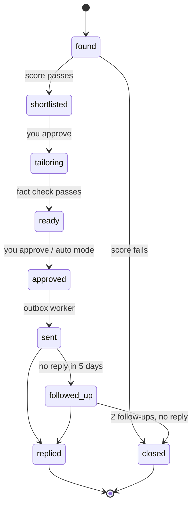

# Process flow

The full target flow. **Phase 1 builds the lead graph only.** Resume tailoring, sending and calls come in later phases, and nothing is sent to employers yet.

## End to end

```mermaid
flowchart LR
    subgraph T1[1. Lead graph · daily 7am]
        R0[Read resume profile<br/>skills, titles, years, industries] --> Q[Build search queries<br/>title variants + top skills + regions]
        Q --> A[Fetch jobs<br/>Trade Me, Gmail alerts, ATS, SerpApi]
        A --> B[Dedupe]
        B --> C[Enrich company<br/>NZBN, Places, website, Tavily]
        C --> D0[Pre-filter<br/>embedding similarity to resume]
        D0 --> D[Score match vs resume<br/>cheap LLM, must-have skills]
        D --> E{Score >= threshold?}
        E -- no --> X[Archive]
        E -- yes --> F[Shortlist]
    end
    F --> R1{{You review shortlist}}
    R1 -- approve --> G
    subgraph T2[2. Resume graph · on approve]
        G[Read job + employer facts] --> H[Tailor resume + cover note]
        H --> I[Fact check vs base resume]
        I -- fails --> H
        I -- passes --> J[Render PDF]
    end
    J --> R2{{You review resume}}
    R2 -- approve or auto mode --> K
    subgraph T3[3. Outreach graph · every 15 min]
        K[Queue in outbox] --> L{Daily limit left?}
        L -- no --> K
        L -- yes --> M[Send email]
        M --> N[Optional WhatsApp]
        N --> O[Schedule follow-up +5 working days]
        O --> P{Reply?}
        P -- yes --> RP[Mark replied]
        P -- no, 1st time --> S[Send follow-up]
        P -- no, 2nd time --> U[Optional AI call via OmniDimension]
        U --> V[Send details by email + WhatsApp]
    end
```

## Job status lifecycle

## Lead graph rules in Phase 1

- A failing job source is reported and the other sources continue.
- Any other failure rolls back the whole run and records the failing step in `graph_runs`.
- Jobs are cleaned before storage: expired posts, avoided title words, pay below the floor, and places outside your regions are removed.
- Scoring is free keyword matching until an LLM chain is added. A job needing something you lack is capped at 40.
